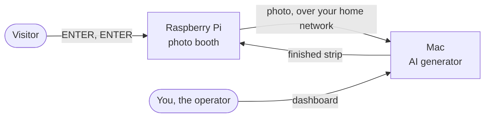

# Fotobox: the AI photo booth

**A photo booth that turns one photo of a visitor into a funny photo strip: the visitor and an invented second person act out a short story in four pictures.**

Everything happens on your own devices. A Raspberry Pi with a webcam, screen and keyboard takes the photo, and a Mac on the same network creates the strip with an AI image model. No photo is sent to the internet or to a cloud service.

> **Status: development version.** Good for supervised tests on your own network. Not yet ready for unsupervised use in public; see [Before you use it with the public](#before-you-use-it-with-the-public).

---

## How a visit works

1. **Start.** The visitor presses ENTER on the photo booth's keyboard.
2. **Agree.** A short notice explains what happens with the photo. The visitor presses ENTER again to agree, or ESC to leave. No photo is taken without this.
3. **Smile.** A 3-2-1 countdown, then the webcam takes the photo.
4. **Wait.** About three minutes. A timer shows the progress.
5. **Watch.** The finished strip appears on the screen for 20 seconds, with a personal deletion code next to it.
6. **Gone.** One hour later the photo and the strip are deleted automatically. With the code, the visitor can have them deleted sooner.

## What the strips look like

Each strip has four pictures with one plain colored background, like a real photo booth. The visitor and an invented counterpart play out one of **100 short stories**, chosen at random: a pigeon lands on someone's head, a balloon grows until it bursts, a llama wanders in, a marching band takes over. People stand at different distances from the camera, overlap and move, so every strip looks different.

The stories are written to be friendly between strangers: nothing romantic, no weapons, and no jokes about how anyone looks.

## Features

| | |
|---|---|
| **Simple for visitors** | Only ENTER and ESC; screens in German and English. |
| **Consent first** | Your consent notice is shown before every photo, and each agreement is recorded together with the exact text that was shown. |
| **Private by design** | Everything stays on your network, photos are deleted after an hour, and no face recognition is used. |
| **Deletion on request** | Each visitor gets a code, and one command deletes their pictures everywhere. |
| **Dashboard for you** | A web page on the Mac showing the booth, the queue and the strips, where you can also edit the consent notice and the stories. |
| **Setup at the booth** | WiFi, server and camera are set up with the booth's own keyboard, protected by a PIN. |
| **Meet earlier visitors** | Optionally, visitors can agree, as a separate question, that their photo is combined with other visitors' photos for 24 hours. The end time is shown, and the photo is deleted then. |
| **Live encounters** | With two booths, visitors photographed at about the same time share one strip, and both get it. |
| **Booths that know about each other** | Each booth's start screen tells what is happening at the others, such as "Someone is taking a photo in Hall B", only ever from what really happened. |
| **Runs on its own** | Everything starts automatically after a restart, and unfinished strips continue. |

## What you need

| Part | What exactly | Notes |
|---|---|---|
| **Mac** | Apple Silicon (M1 or newer), about 20 GB free space | Creates the strips. Tested on a MacBook Pro M3 Max with 64 GB. |
| **Raspberry Pi 5** | With a power supply and a memory card | Runs the photo booth. |
| **USB webcam** | Any standard webcam | Tested with a Logitech BRIO. |
| **Screen and USB keyboard** | Connected to the Pi | Any HDMI screen. |
| **Network** | Mac and Pi in the same home or office network | A network you trust; see the limits below. |

## Get started

**👉 Follow the [installation guide](INSTALL.md).** It goes step by step, explains every command, and needs no programming knowledge. Plan about an hour, plus the time to download the AI model (about 15 GB).

## Documentation

| If you want to … | Read |
|---|---|
| Install the photo booth | [INSTALL.md](INSTALL.md) |
| Run it day to day: dashboard, deleting a visitor's pictures, changing stories, fixing problems | [Operator guide](docs/OPERATOR_GUIDE.md) |
| Understand how it is built, or change the code | [Developer guide](docs/DEVELOPMENT.md) and the [technical documentation](docs/README.md) |

## Before you use it with the public

This is a development version. Please keep these limits in mind:

- **Your network must be trusted.** Photos travel between the Pi and the Mac without encryption. Use it only in a network where you trust everyone.
- **The consent notice is your responsibility.** The included text is a draft, not legal advice. Have it checked, and in the EU carry out a data protection assessment (GDPR) before public use.
- **A key press is not an identity check.** The booth records that the notice was confirmed, not who confirmed it or how old they are.
- **The deletion code appears on screen,** where people nearby may see it.
- **Not tested enough with real visitors.** How well two real people stay recognizable in the current stories has not been measured yet.
- **Not yet available:** printing, a touchscreen, and several booths at once.

## License

No license has been chosen yet, so the usual copyright rules apply.
