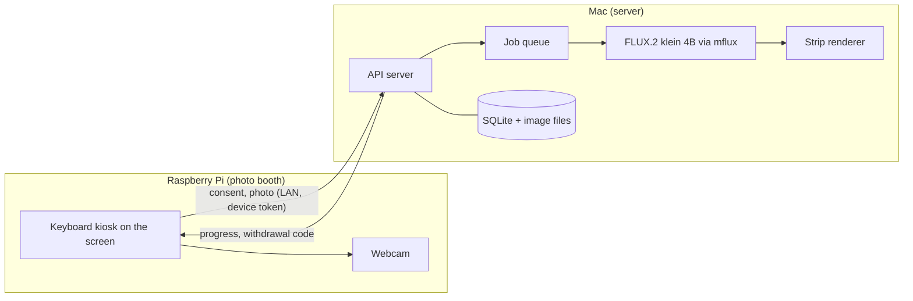

# Connected Photobox: user guide

A photo booth that turns one photo of a visitor into an AI-generated photo strip, in which the visitor and an invented second person play out a short, funny story. A Raspberry Pi with a webcam, screen and keyboard takes the photo. A Mac on the same network generates the strip locally, with no cloud service.

> **Status: development version (V0.5, phase 1).** Suitable for supervised tests on a trusted network. It is not ready for unsupervised public use: see [Limits](#limits-and-responsibilities).

**Contents**
1. [What it does](#what-it-does)
2. [How it works](#how-it-works)
3. [Features](#features)
4. [What you need](#what-you-need)
5. [Installing the server on the Mac](#installing-the-server-on-the-mac)
6. [Installing the client on the Raspberry Pi](#installing-the-client-on-the-raspberry-pi)
7. [Using the photo booth](#using-the-photo-booth)
8. [Operator tasks](#operator-tasks)
9. [Configuration reference](#configuration-reference)
10. [Updating](#updating)
11. [Troubleshooting](#troubleshooting)
12. [Limits and responsibilities](#limits-and-responsibilities)

---

## What it does

A visitor presses ENTER on the photo booth's keyboard, reads a short consent notice on the screen and confirms it with a second ENTER. After a 3-2-1 countdown the webcam takes their photo. About three minutes later the Mac has generated a vertical strip of four frames, in a photo booth style: one colored backdrop, a micro-story such as a pigeon landing on someone's head or a balloon that grows until it bursts, and the visitor as one of the two main characters. The visitor's photo and strip are deleted automatically after one hour.

## How it works



1. **Consent:** the kiosk fetches the consent notice from the server and shows it. Only after the visitor confirms is consent recorded, together with the exact version of the text they saw.
2. **Photo:** the webcam takes a 1920×1080 photo, which the Pi uploads to the Mac.
3. **Matching:** the server picks the counterpart for the strip: a portrait from the temporary pool, if someone agreed to that, otherwise a rights-cleared seed image.
4. **Generation:** a worker picks one of 100 micro-stories and a backdrop at random and generates four frames with FLUX.2 klein 4B, each with its own staging of distance, depth and pose.
5. **Strip:** the frames are checked, composed into a strip with a dated footer and stored on the Mac.
6. **Deletion:** the photo and strip are deleted automatically after one hour, or immediately if the visitor withdraws.

## Features

### For visitors
| Feature | Details |
|---|---|
| **Keyboard operation** | ENTER to start, ENTER to confirm, ESC to cancel. Nothing else is needed. |
| **Consent on screen** | The operator's notice is shown before any photo is taken. Waiting 90 s or pressing ESC cancels without a photo. |
| **Countdown** | A large 3-2-1 before the photo is taken. |
| **Progress timer** | Elapsed time and "frame x of 4" while the strip is generated. |
| **Withdrawal code** | Shown at the end. The operator can use it to delete the visitor's images at any time. |
| **German and English** | All kiosk screens are bilingual. |

### The strips
| Feature | Details |
|---|---|
| **Photo booth look** | One plain backdrop per strip (mustard, teal, coral or pale pink), wide 4:3 frames at a fixed eye-level camera, even white borders and a dated footer. |
| **100 micro-stories** | Each strip tells one short story across its frames, chosen at random: pigeons, kittens, a marching band, a llama, zero gravity, a magician and more. |
| **Dynamic staging** | Every frame gets its own arrangement of distance to the camera, foreground and background, body position and asymmetry. |
| **Recognizable people** | The visitor stays a main character, and the first frame always shows both faces clearly. Invented extras may appear. |
| **Friendly by design** | Stories avoid romance, weapons and jokes about anyone's looks, because the two people on a strip may be strangers. |
| **Quality checks** | Frames that are too small, unreadable or blank are regenerated automatically. An optional face count can limit invented people. |
| **Output profiles** | Color (stored), plus grayscale and 1-bit thermal-printer versions made on request. |
| **Clear origin** | The footer says "AI GENERATED". The development mock is labelled "MOCK / NOT AI" on every frame. |

### Privacy and safety
| Feature | Details |
|---|---|
| **Local only** | Photos never leave the local network. The model runs offline on the Mac. |
| **Short retention** | Visitor photos and their strips are deleted after one hour, by an automatic cleanup that runs every 5 minutes. |
| **Withdrawal** | One command deletes a visitor's images and every strip they appear in. |
| **Versioned consent** | Each consent records the method and a hash-based version of the notice that was shown. |
| **No face recognition** | No face embeddings or comparisons are ever computed. The optional face count only counts faces. |
| **Device tokens** | Every request except the health check needs a per-device token, stored only as a hash. |
| **Private files** | Storage folders are readable only by the server's user account. |
| **Audit trail** | Consent, use, deletion and seed events are logged with opaque IDs, never images or names. |

### For operators
| Feature | Details |
|---|---|
| **Starts on its own** | The server starts at login on the Mac, and the kiosk starts at boot on the Pi. |
| **Survives restarts** | Jobs are stored in a queue and resume from finished frames after a restart. |
| **Admin commands** | Manage devices, seed images, withdrawals and cleanup, and view the audit trail. None of these are reachable over the network. |
| **Evaluation tool** | `scripts/evaluate_pairs.py` makes test strips from portrait pairs, with a review page and score sheet. |

## What you need

| | Requirement | Tested with |
|---|---|---|
| **Server** | Mac with Apple Silicon, Python 3.11 or newer, about 20 GB free disk space. Generation peaked at about 10 GB of MLX memory; smaller Macs than the tested one have not been tried | MacBook Pro M3 Max, 64 GB, Python 3.13 |
| **Photo booth** | Raspberry Pi 5 with Raspberry Pi OS 64-bit, USB webcam (UVC), HDMI screen, USB keyboard | Pi 5 (4 GB), Debian 13, Logitech BRIO, 4K monitor |
| **Network** | Both on the same trusted LAN | Home network |
| **Software** | [uv](https://docs.astral.sh/uv/) to install mflux | mflux 0.24.0 |

A Mac Studio is the intended long-term server; the server has not run there yet.

---

## Installing the server on the Mac

> Use `python3` in the commands below, or the `.venv/bin/python` paths shown. Some shells alias `python` to the system Python 3.9, which is too old.

### 1. Put the server outside `~/Documents`
macOS does not let background services read `~/Documents`, `~/Desktop` or `~/Downloads`. Install the server in a folder of its own, such as `~/photobox-server`:
```bash
git clone /path/to/Fotobox ~/photobox-server
```
```bash
cd ~/photobox-server
```

### 2. Create the Python environment
```bash
python3 -m venv .venv && .venv/bin/pip install --upgrade pip && .venv/bin/pip install -e '.[server-ai]'
```

### 3. Install mflux and download the model
```bash
uv tool install mflux
```
The first generation downloads FLUX.2 klein 4B, about 15 GB under the Apache 2.0 license. The server itself runs mflux offline, so download it once by hand:
```bash
~/.local/bin/mflux-generate-flux2 --model flux2-klein-4b -q 8 --prompt "a red apple on a table" --steps 4 --width 512 --height 512 --output /tmp/mflux-test.png
```

### 4. Configure
```bash
cp .env.example .env && chmod 600 .env
```
Edit `.env` and set at least these lines:
```ini
PHOTOBOX_PROVIDER=mflux-flux2
PHOTOBOX_DEVELOPER_MODE=false
PHOTOBOX_MFLUX_COMMAND=/Users/YOUR_NAME/.local/bin/mflux-generate-flux2-edit
PHOTOBOX_CONSENT_NOTICE_FILE=/Users/YOUR_NAME/photobox-server/consent-notice.txt
```
See the [configuration reference](#configuration-reference) for every setting.

### 5. Write the consent notice
```bash
cp consent-notice.example.txt consent-notice.txt && open -e consent-notice.txt
```
Replace every `TODO-OPERATOR`: the minimum age, and who is responsible, with name and contact. Until then the server refuses to serve the notice, and the kiosk shows "not ready". Save it as plain text. The example is a draft, not legal advice: have it checked before public use.

### 6. Add counterparts (seed images)
Visitors need someone to share their strip with. Import at least one rights-cleared portrait, for example a fictional AI-generated face:
```bash
.venv/bin/python -m photobox_server.admin seed add /path/to/portrait.png --rights-reference FICTIONAL-AI --attest-rights
```
Only import images you have the rights to use. `--rights-reference` is a licence or permission reference, never personal data.

### 7. Register the photo booth
```bash
.venv/bin/python -m photobox_server.admin device add pi-01
```
This prints a token once. Copy it for the Pi setup; only its hash is stored.

### 8. Start the server at login
```bash
sed -e "s|REPOSITORY|$PWD|g" -e "s|HOME|$HOME|g" deploy/mac/com.photobox.server.plist > ~/Library/LaunchAgents/com.photobox.server.plist && launchctl bootstrap gui/$(id -u) ~/Library/LaunchAgents/com.photobox.server.plist
```
The server binds to the Mac's current LAN address on `en0`, never to `0.0.0.0`. If macOS asks whether Python may accept incoming connections, allow it.

### 9. Keep photos out of backups
```bash
tmutil addexclusion ~/photobox-server/storage
```

### 10. Check
```bash
curl -s http://$(ipconfig getifaddr en0):8000/api/v1/health
```
Expected: `{"status":"ok","provider":"mflux-flux2","production_ready":false}`. The log is in `~/Library/Logs/photobox-server.log`.

---

## Installing the client on the Raspberry Pi

### 1. Copy the code and create the environment
From the Mac, copy the code to the Pi, replacing `PI` with its SSH address, such as `admin@192.168.1.140`:
```bash
cd ~/photobox-server && git ls-files | tar -c -T - | ssh PI 'mkdir -p ~/photobox && tar -x -C ~/photobox'
```
Then on the Pi:
```bash
cd ~/photobox && python3 -m venv .venv && .venv/bin/pip install -e '.[client-camera]'
```

### 2. Store the device token
```bash
install -m 600 /dev/null ~/.photobox.token && nano ~/.photobox.token
```
Paste the token from server step 7 and save.

### 3. Find the camera
```bash
.venv/bin/python -m photobox_client.cli camera-list
```
Use the stable `.../by-id/...-video-index0` name, which stays the same after a reboot, unlike `/dev/video0`. To check it without uploading anything:
```bash
.venv/bin/python -m photobox_client.cli camera-probe --camera /dev/v4l/by-id/YOUR-CAMERA-video-index0
```

### 4. Configure and start the kiosk
```bash
printf 'PHOTOBOX_SERVER=http://MAC_LAN_IP:8000\nPHOTOBOX_CAMERA=/dev/v4l/by-id/YOUR-CAMERA-video-index0\n' > ~/.photobox-kiosk.env && chmod 600 ~/.photobox-kiosk.env
```
```bash
sudo cp ~/photobox/deploy/pi/photobox-kiosk.service /etc/systemd/system/ && sudo systemctl daemon-reload && sudo systemctl enable --now photobox-kiosk
```
The kiosk replaces the login prompt on the Pi's screen (tty1), starts at every boot and sets a large console font. The service file assumes the user `admin`; change `User=` and the paths in it if yours differs.

To get the login prompt back:
```bash
sudo systemctl disable --now photobox-kiosk && sudo systemctl start getty@tty1
```

### 5. Try it without a person
```bash
.venv/bin/python -m photobox_client.kiosk --server http://MAC_LAN_IP:8000 --token-file ~/.photobox.token --test-image /path/to/fictional.png --once
```
"TEST MODE - no camera" is shown on every screen.

---

## Using the photo booth

### The visitor's view
| Screen | What to do |
|---|---|
| **FOTOBOX – Press ENTER to start** | Press ENTER. |
| **Consent notice** | Read it, then press ENTER to agree or ESC to cancel. After 90 s without an answer, it cancels. |
| **3 – 2 – 1** | Look at the camera. |
| **Your photo strip is being made** | Wait about 3 minutes. A timer and "frame x of 4" show progress. |
| **Done! Your withdrawal code** | Note the code; it is shown for 60 s or until ENTER. |

Keys pressed before a screen appears are ignored, so pressing ENTER twice quickly can never count as consent.

### Where the strips are
On the Mac, in `~/photobox-server/storage/generated/`, one PNG per session:
```bash
open ~/photobox-server/storage/generated
```
They are deleted with the visitor's photo after about one hour. To keep a strip, copy it before then, and only with the visitor's permission.

### Other formats
Through the API or the Pi's command line, a strip can be fetched as `color`, `grayscale` or `thermal`:
```bash
.venv/bin/python -m photobox_client.cli --server http://MAC_LAN_IP:8000 --token-file ~/.photobox.token result SESSION_ID --profile thermal --output strip-thermal.png
```

---

## Operator tasks

Run these on the Mac in `~/photobox-server`. None of them can be reached over the network.

| Task | Command |
|---|---|
| Delete a visitor's images (they give you their code) | `.venv/bin/python -m photobox_server.admin withdraw`, then type the code when asked |
| Delete by session ID instead | `.venv/bin/python -m photobox_server.admin withdraw --session SESSION_ID` |
| List, add or remove seed images | `... admin seed list`, `... admin seed add FILE --rights-reference REF --attest-rights`, `... admin seed remove SEED_ID` |
| Register, list or revoke photo booths | `... admin device add NAME`, `... admin device list`, `... admin device revoke NAME` |
| View the audit trail | `... admin audit --limit 50` |
| Run cleanup now | `... admin cleanup` |
| Stop or start the server | `launchctl bootout gui/$(id -u)/com.photobox.server`, or step 8 again |
| Restart the server | `launchctl kickstart -k gui/$(id -u)/com.photobox.server` |
| Restart the kiosk | On the Pi: `sudo systemctl restart photobox-kiosk` |

A withdrawal deletes the visitor's images and every strip containing them, including other visitors' strips, and stops any generation in progress. It cannot reach copies already saved elsewhere or backups.

---

## Configuration reference

Server settings go in `~/photobox-server/.env`. Variables set in the shell take precedence. Invalid values stop the server at startup, with a message naming the setting.

| Setting | Default | Meaning |
|---|---|---|
| `PHOTOBOX_PROVIDER` | `mock` | `mflux-flux2` for real generation. `mock` is not AI and needs developer mode. |
| `PHOTOBOX_DEVELOPER_MODE` | off | `true` allows the mock. Keep it off in operation. |
| `PHOTOBOX_MFLUX_COMMAND` | `mflux-generate-flux2-edit` | Full path to mflux if it is not on the PATH. |
| `PHOTOBOX_MFLUX_STEPS` / `_QUANTIZE` | `4` / `8` | Model steps and quantization. |
| `PHOTOBOX_MAX_FACES` | unset | Optional: regenerate frames with more faces than this (2–20). |
| `PHOTOBOX_CONSENT_NOTICE_FILE` | `consent-notice.txt` | The notice shown by the kiosk. |
| `PHOTOBOX_NUM_FRAMES` | `4` | Frames per strip: 3 or 4. |
| `PHOTOBOX_GENERATION_FRAME_TIMEOUT_SECONDS` | `600` | Time limit per frame. |
| `PHOTOBOX_GENERATION_MAX_ATTEMPTS` | `3` | Attempts per strip, including after a restart. |
| `PHOTOBOX_GENERATION_RETRY_DELAY_SECONDS` | `30` | Pause before a retry. |
| `PHOTOBOX_STORAGE_DIR` | `./storage` | Photos, strips, seeds and the database. |
| `PHOTOBOX_DB_PATH` | inside storage | SQLite database location. |
| `PHOTOBOX_POOL_HOURS` | `24` | How long pool portraits are kept (1–720). The kiosk never adds to the pool. |
| `PHOTOBOX_CLEANUP_INTERVAL_SECONDS` | `300` | How often expired images are deleted. |
| `PHOTOBOX_MAX_UPLOAD_BYTES` | `10000000` | Largest accepted photo. |
| `PHOTOBOX_MAX_UPLOADS_PER_MINUTE` | `30` | Per photo booth. |
| `PHOTOBOX_STRIP_WIDTH` | `560` | Strip width in pixels; set to the printer's width once one is chosen. |
| `PHOTOBOX_THERMAL_BRIGHTNESS` / `_CONTRAST` | `1.1` / `1.3` | Thermal profile adjustments. |
| `PHOTOBOX_INTERFACE` / `PHOTOBOX_PORT` | `en0` / `8000` | Used by `scripts/run_server.sh`. |

Kiosk settings on the Pi are in `~/.photobox-kiosk.env` (`PHOTOBOX_SERVER`, `PHOTOBOX_CAMERA`). Further options such as `--width`, `--height`, `--rotate` and `--wait-seconds` can be added to `ExecStart` in the service file.

---

## Updating

**Server:**
```bash
cd ~/photobox-server && git pull && .venv/bin/pip install -e '.[server-ai]' && launchctl kickstart -k gui/$(id -u)/com.photobox.server
```
The database is migrated automatically on start.

**Pi:** copy the code as in client step 1, then restart the kiosk:
```bash
sudo systemctl restart photobox-kiosk
```

---

## Troubleshooting

| Symptom | Cause and fix |
|---|---|
| **Pi screen looks empty** | On a 4K screen the console text is tiny and sits in a corner that TVs often cut off. The kiosk service sets a large font; restart it with `sudo systemctl restart photobox-kiosk`. Also check the monitor's input. |
| **Kiosk says "not ready"** | The server is not reachable, or the consent notice is missing or still has `TODO-OPERATOR`. Check the notice and run the health check. |
| **Kiosk says "Could not reach the server"** | The network failed, or no counterpart is available: import a seed image. |
| **Server log: "Operation not permitted"** | The service points into `~/Documents`. Install it from a folder outside it, as in server step 1. |
| **`Bootstrap failed: 5`** | The service is already loaded. Run `launchctl bootout gui/$(id -u)/com.photobox.server` first, or ignore it if the server already runs. |
| **The Pi can't connect after a while** | The Mac's LAN address changed. Update `PHOTOBOX_SERVER` in `~/.photobox-kiosk.env` and restart the kiosk, or give the Mac a fixed address in your router. |
| **Server won't start: "PHOTOBOX_... must be ..."** | An invalid setting in `.env`; the message names it. |
| **Server won't start: "mflux was not found"** | Set `PHOTOBOX_MFLUX_COMMAND` to the full path. |
| **Generation fails at once** | The model is not downloaded yet; see server step 3, because the server runs offline. |
| **A strip has disappeared** | Strips expire with the visitor's photo after about one hour. |
| **`python: command not found` or a wrong version** | Use `python3` or `.venv/bin/python`. |
| **Camera errors** | Run `camera-list` and `camera-probe`, and use the stable `by-id` name. Unplugging and replugging the camera can change `/dev/videoN`. |

---

## Limits and responsibilities

- **Network:** photos and tokens travel over the LAN unencrypted until NetBird or Tailscale is added. Use only a trusted network.
- **Consent:** pressing ENTER records that the notice was confirmed, not who confirmed it or their age. The notice is your text and your responsibility; have it reviewed before public use. Public operation requires a GDPR assessment by the controller.
- **Withdrawal codes** are shown on screen, where bystanders may see them.
- **Identity retention** was scored at 4.6 out of 5 on an evaluation set with fictional faces and one real person. That was for the earlier scene prompts; the current micro-stories have not been scored, and two real visitors together are untested.
- **Backups:** deletion cannot reach copies in backups, so keep `storage/` excluded from Time Machine.
- **Not yet available:** printing, a touchscreen, several photo booths and self-service withdrawal.

For the technical background, see [ARCHITECTURE.md](ARCHITECTURE.md), [API.md](API.md), [PRIVACY.md](PRIVACY.md), [SECURITY.md](SECURITY.md) and the decisions in [DECISIONS.md](DECISIONS.md).
